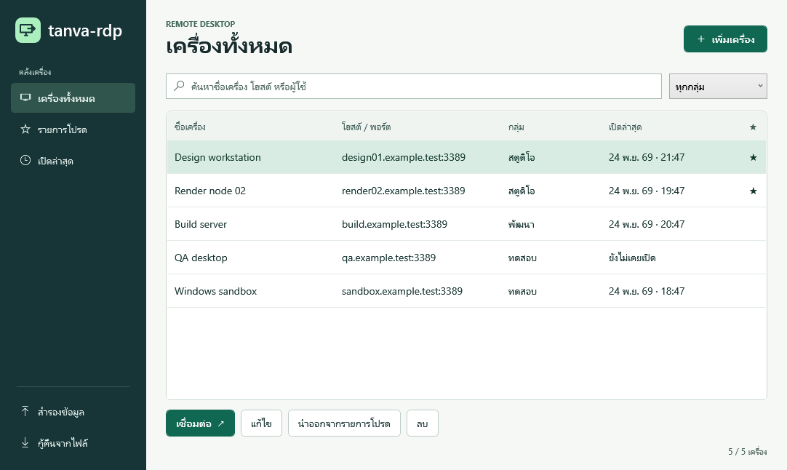

# tanva-rdp

โปรแกรมจัดการ Remote Desktop สำหรับ Windows เขียนด้วย C# และ WPF หน้าจอภาษาไทย เปิดจากไฟล์เดียว เก็บโปรไฟล์ไว้ในเครื่อง และส่งการเชื่อมต่อให้ Remote Desktop Connection ของ Windows

**[ดาวน์โหลด tanva-rdp.exe รุ่นล่าสุด](https://github.com/QUITFIL3/tanva-rdp/releases/latest/download/tanva-rdp.exe)** · [ดูทุกรุ่น](https://github.com/QUITFIL3/tanva-rdp/releases)



## เริ่มใช้งาน

ต้องใช้ Windows 10 หรือ 11 ที่มี .NET Framework 4.8 ขึ้นไปและ `mstsc.exe` เครื่องปลายทางต้องเปิดรับ Remote Desktop และบัญชีที่ใช้ต้องมีสิทธิ์เข้าใช้งาน

1. เปิด `tanva-rdp.exe` แล้วกด **เพิ่มเครื่อง** หรือ **Ctrl+N**
2. ใส่ชื่อที่ใช้เรียกเครื่อง ชื่อโฮสต์หรือ IP และพอร์ต ค่าเริ่มต้นคือ 3389
3. เลือกกลุ่ม ชื่อผู้ใช้ และรูปแบบหน้าจอตามต้องการ เว้นช่องรหัสผ่านว่างได้หากต้องการเข้าสู่ระบบผ่าน Windows
4. กด **บันทึก** แล้วดับเบิลคลิกเครื่อง หรือเลือกเครื่องแล้วกด **Enter** เพื่อเปิด Remote Desktop

## จัดการเครื่อง

- กด **Ctrl+F** เพื่อค้นหาชื่อเครื่อง โฮสต์ พอร์ต กลุ่ม หรือผู้ใช้ แล้วกรองรายการด้วยเมนูกลุ่ม
- เพิ่มเครื่องที่ใช้บ่อยใน **รายการโปรด** หรือดูเวลาเปิดไคลเอนต์ใน **เปิดล่าสุด**
- เลือกเต็มจอ หน้าต่าง 1280 × 720 หรือหลายจอต่อโปรไฟล์ และเปิดการแชร์คลิปบอร์ดเฉพาะเครื่องที่ต้องการ
- รองรับชื่อโฮสต์ IPv4 และ IPv6 โดยแยกช่องพอร์ตออกจากที่อยู่

## สำรองและย้ายเครื่อง

กด **สำรองข้อมูล** เลือกที่เก็บไฟล์ `.tanva` และตั้งรหัสผ่านสำหรับเปิดไฟล์อย่างน้อย 12 ตัวอักษร บนเครื่องปลายทาง เปิด tanva-rdp แล้วกด **กู้คืนจากไฟล์** และใส่รหัสผ่านเดิม แอปเพิ่มเฉพาะโปรไฟล์ที่มีรหัสประจำรายการใหม่ การกู้คืนซ้ำจึงรักษาโปรไฟล์ที่แก้ไขไว้ในคลังปัจจุบัน

คลังใน `%LOCALAPPDATA%\tanva-rdp\library.dat` ใช้ Windows DPAPI ผูกกับบัญชี Windows ส่วนไฟล์สำรองเข้ารหัสโปรไฟล์ทั้งหมด รวมถึงรหัสผ่าน RDP ด้วย AES-256-CBC และตรวจสอบความถูกต้องด้วย HMAC-SHA-256 โดยแยกกุญแจจาก PBKDF2-HMAC-SHA-256 จำนวน 600,000 รอบ เก็บรหัสผ่านสำรองไว้เพื่อใช้ตอนกู้คืน

เมื่อเชื่อมต่อ แอปจะสร้างไฟล์ `.rdp` ชั่วคราวในโฟลเดอร์ `sessions` โดยส่งรหัสผ่านที่บันทึกไว้ในรูปแบบ DPAPI การใช้รหัสผ่านที่บันทึกขึ้นอยู่กับนโยบายของ Windows และเครื่องปลายทาง แอปจะลบไฟล์เมื่อไคลเอนต์ปิดขณะที่แอปยังเปิดอยู่ และเก็บกวาดไฟล์ที่ค้างเกินหนึ่งวันเมื่อเปิดแอปครั้งถัดไป

## บิลด์และทดสอบ

ใช้ PowerShell บน Windows ที่มี .NET Framework 4.8 ขึ้นไป สคริปต์เรียก C# compiler ของ .NET Framework โดยตรง

```powershell
.\build.ps1
.\tests\test.ps1
```

ไฟล์ที่บิลด์ได้อยู่ที่ `bin\tanva-rdp.exe` ชุดทดสอบใช้โปรไฟล์สมมติในโฟลเดอร์ชั่วคราว เพื่อตรวจการเปิดไคลเอนต์ `mstsc.exe` จริงบน loopback และการลบไฟล์เซสชันด้วย ให้รัน `.\tests\test.ps1 -LaunchCheck` การทดสอบนี้สิ้นสุดเมื่อเปิดไคลเอนต์และตรวจสอบประวัติแล้ว การยืนยันตัวตนกับเซิร์ฟเวอร์ RDP ต้องทดสอบกับเครื่องที่อนุญาตให้เชื่อมต่อ

แนวคิดการจัดการโปรไฟล์และใช้ไคลเอนต์ Windows มาจาก [RDP Portal ของ louislam](https://github.com/louislam/rdp-portal)
